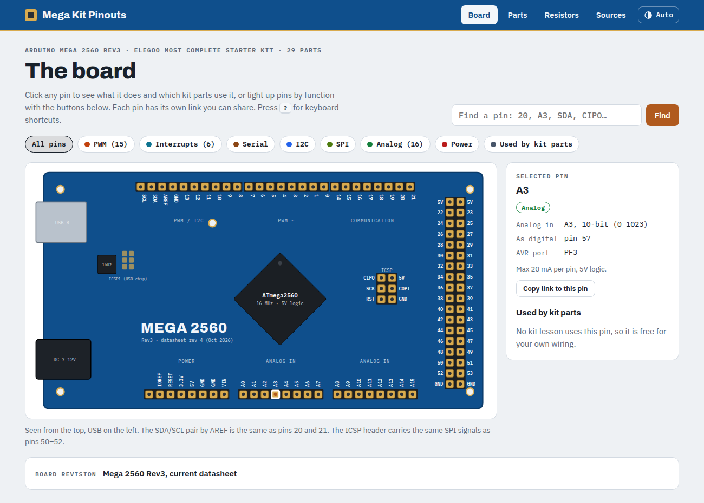

# Mega Kit Pinouts

An interactive pinout reference for the **Arduino Mega 2560 Rev3** and every part in the **ELEGOO Mega 2560 "The Most Complete Starter Kit"**.

**Live site: [pinouts.01blue.org](https://pinouts.01blue.org)**



## What's on it

- **Board**: a clickable drawing of the Mega 2560 Rev3. Pick any pin to see its functions (PWM, interrupts, serial, I2C, SPI, analog), its AVR port, and which kit parts use it. Filter buttons light up pins by function, and you can search by name (`20`, `A3`, `SDA`, `CIPO`…).
- **Parts**: all 29 kit parts, colour-coded by type. Each part page has a drawn pinout, wiring diagrams taken from the kit lessons, the resistors it needs, notes, and datasheet links.
- **Resistors**: quick rules, an LED resistor calculator that picks the closest value in the kit, the kit's colour bands, and a table of every part's resistors.
- **Sources**: every datasheet and reference the site is based on.

Also included: a light/dark theme switch (follows your system by default), shareable links to individual pins and parts, keyboard shortcuts (press `?` on the site), and print-friendly part pages.

## Where the facts come from

- Board facts follow Arduino's current **Mega 2560 Rev3 datasheet (rev 4, Oct 2026)** and Microchip's ATmega2560 datasheet. ELEGOO's 2018 board sheet in the kit download is out of date (it says 14 PWM pins, an 8U2 USB chip, and 40 mA per pin), so the site doesn't follow it.
- Kit wiring comes from the pin numbers in **ELEGOO's own lesson sketches** (kit download V1.0.2023.05.05).
- `kit-pdfs/` holds the component datasheets from ELEGOO's kit download for convenience. They belong to ELEGOO and the original manufacturers.

This is an unofficial reference, not affiliated with Arduino or ELEGOO. Double-check your own board before you power anything.

## Running it locally

It's a plain static site with no build step:

```bash
python3 -m http.server 8000
# then open http://localhost:8000
```

| File | What it holds |
|---|---|
| `index.html` | Page layout and the four tabs |
| `style.css` | Styles and the light/dark colour tokens |
| `data.js` | Board facts, the 29 parts, their wiring and resistors, and the source links |
| `app.js` | Board drawing, part pages, wiring diagrams, routing, theme switch, shortcuts |

To fix a part's pins or wiring, edit its entry in `COMPONENTS` in `data.js`. The diagrams and tables are generated from that.

## Found a mistake?

[Open an issue](https://github.com/Eagle10021/Mega-Pinouts/issues) with the part or pin, and the source that says otherwise.
